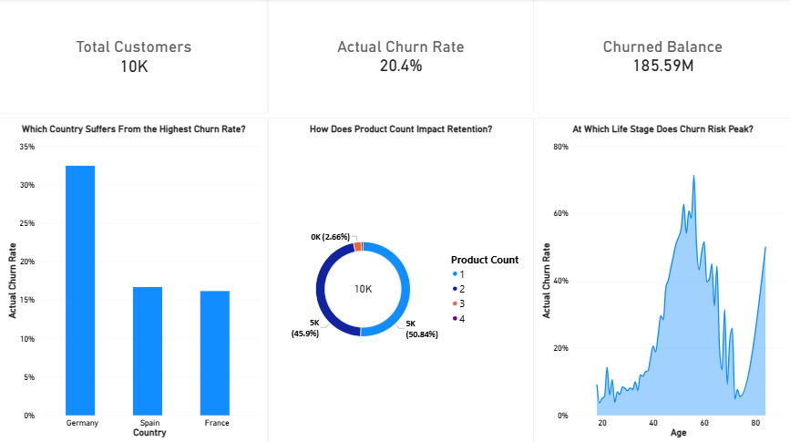
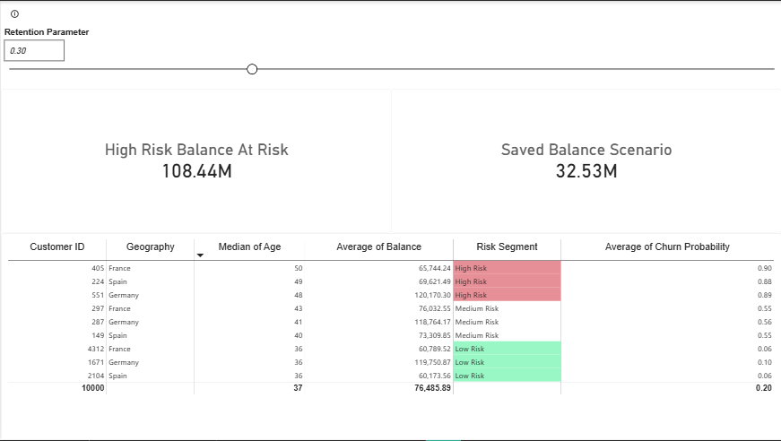

# 🏦 Bank Customer Churn Prediction & Risk Analytics Dashboard

This end-to-end data science and business intelligence project predicts bank customer churn using machine learning models and translates these insights into an interactive Power BI dashboard for risk management and retention simulation.

---

## 🎯 Project Objective

To build an accurate predictive machine learning model and a decision-support dashboard that helps banks proactively identify high-risk customers, understand core churn drivers, and simulate retention strategies to prevent financial loss.

---

## 📦 Dataset

- **Source:** [Kaggle – Churn Modelling Dataset](https://www.kaggle.com/datasets/adammaus/predicting-churn-for-bank-customers)
- **Record Count:** 10,000 customers
- **Key Features:** Credit Score, Geography, Gender, Age, Tenure, Balance, NumOfProducts, HasCrCard, IsActiveMember, EstimatedSalary.
- **Target Variable:** `Exited` (1 = Customer churned, 0 = Customer stayed)

---

## 🔍 Exploratory Data Analysis (EDA)

- Visualized overall churn distribution (pie charts, bar plots).
- Analyzed churn rates across demographics and attributes such as `Geography`, `Gender`, `IsActiveMember`, and `HasCrCard`.
- Evaluated feature interdependencies using correlation heatmaps.

---

## 🛠️ Data Preprocessing

- Dropped irrelevant identifiers: `RowNumber`, `CustomerId`, `Surname`.
- Encoded categorical variables using one-hot encoding (`get_dummies()`).
- Scaled numerical features using `StandardScaler`.
- Split the dataset into training and testing sets (80% - 20%).

---

## 🤖 Machine Learning Models

The following models were trained and evaluated:
- Logistic Regression (used as a baseline)
- Random Forest Classifier (optimized via `GridSearchCV` for `n_estimators`, `max_depth`, and `min_samples_split`)
- XGBoost Classifier (selected as the final model)
- Support Vector Machine (SVM)

---

## 📈 Model Performance Comparison

| **Model** | **Accuracy** | **Recall (Churn)** | **Precision (Churn)** | **F1 Score (Churn)** |
| :--- | :--- | :--- | :--- | :--- |
| Logistic Regression | 0.808 | 0.19 | 0.59 | 0.28 |
| Random Forest | 0.860 | 0.46 | 0.78 | 0.58 |
| XGBoost | 0.850 | **0.49** | **0.70** | **0.58** |
| SVM | 0.840 | **0.42** | **0.65** | **0.51** |

---

## 📊 Key Insights & Feature Importance (XGBoost)

According to the XGBoost feature importance analysis, the top drivers for customer churn are:
1. **Age (`Age`)** – Older customer segments exhibit higher churn tendencies.
2. **Activity Status (`IsActiveMember`)** – Inactive members are significantly more likely to leave.
3. **Geography (`Geography_Germany`)** – Customers based in Germany show higher dropout rates compared to other regions.

---

## 📊 Power BI Executive Dashboard

To bridge the gap between machine learning predictions and business execution, an interactive two-page Power BI dashboard was developed.

### Page 1: Executive Overview
Provides high-level portfolio metrics, geographic breakdowns, product impact analysis, and age-based risk distribution.
>  *(Note: Replace with your actual screenshot filename if different)*

### Page 2: Predictive Action & Risk Prevention
Features a **What-If Retention Parameter** slider, dynamic DAX calculations for balance at risk and saved capital scenarios, and a high-risk detail table with exception-based conditional formatting.
>  *(Note: Replace with your actual screenshot filename if different)*

---

## ✅ Conclusion & Business Value

- **XGBoost** was selected as the final production model due to its robust recall and balanced F1-score.
- The integrated Power BI dashboard empowers risk-management teams to simulate retention campaigns dynamically and target high-risk balances effectively.

---

## 🔗 Resources & Links

- **Kaggle Notebook:** [View Notebook on Kaggle](https://www.kaggle.com/code/aeri88/bank-customer-churn-prediction)

---

## 📁 Repository Structure

```text
📦 bank-customer-churn-prediction
┣ 📂 Screenshots
┃  ┣ 📜 executive_overview.png
┃  ┗ 📜 risk_prevention.png
┣ 📄 bank_churn_prediction.ipynb
┗ 📄 README.md
